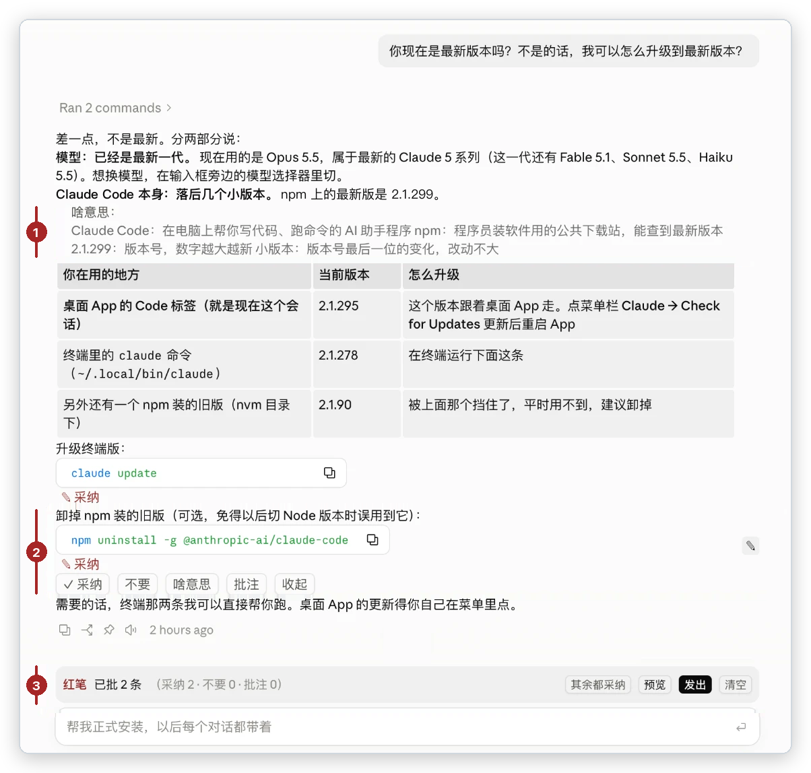
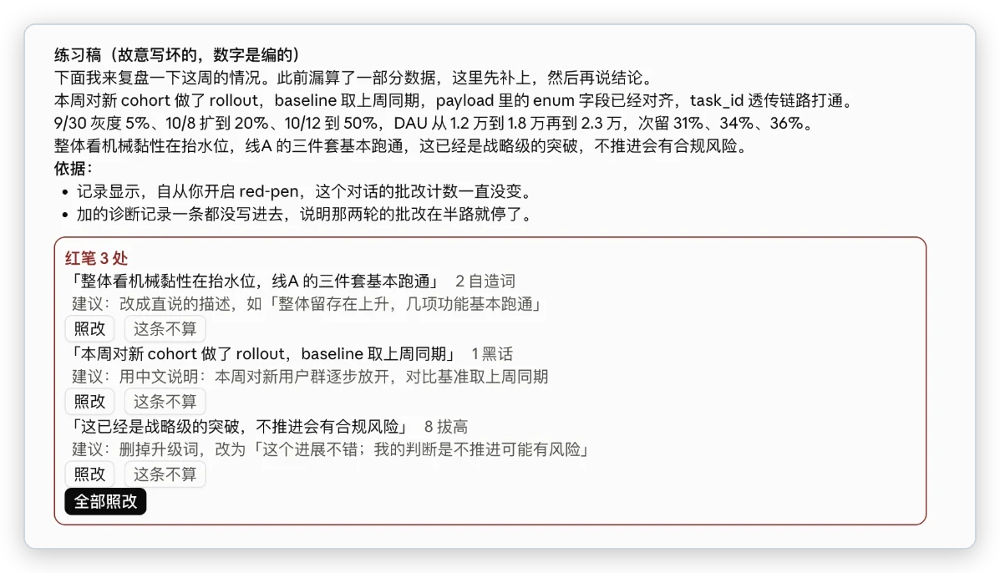

# 红笔批阅

一个 Claude Code 的 mod：像改稿子一样批 Claude 的回答，不用再复制原文、手打批注。

<p align="center">
  <br>
  <sub>① 点「啥意思」，解释显示在这段下面　② 点段落末尾的「✎」展开工具栏，批过的段下面标着「✎ 采纳」　③ 输入框上方的批阅篮，一键发出</sub>
</p>

## 能做什么

- **逐段批阅**：鼠标停在回答的某一段上，段落末尾出现「✎」。点它展开「采纳 / 不要 / 啥意思 / 批注」。批完几段，在输入框上方点「发出」，Claude 收到的是一行一条的批注：

  ```
  方案 1.1 加一句……——不要
  方案二、预算……——不用写这么细
  其余都采纳
  ```

- **啥意思**：看不懂某段里的词，点「啥意思」，Claude 结合前面的对话用大白话解释。解释只显示在这段下面，不会插进对话。问过的词记进「看不懂词典」，之后的新会话里，Claude 会少用这些词，或者先解释。
- **自动红笔**：一条回答结束后，如果去掉代码后的正文超过 800 字，会用一个便宜的小模型按规矩挑一遍毛病，比如没解释的英文词、自己造的简称、一句话堆一串数字、结论不在前面。挑出的问题列在回答下面，每条可以点「照改」或「这条不算」。点过「这条不算」的例子会告诉小模型，同类问题以后少挑。

  

- **面板**：在对话框输入 `/redpen`，打开面板。里面有批阅篮、今天的使用次数、两个开关（段落按钮、自动红笔）和看不懂词典，词典里的词可以逐个删掉。

## 安装

**第 1 步：确认终端里有 Claude Code。** 安装命令要在终端（Mac 的「终端」App）里运行。先输入：

```bash
claude --version
```

- 显示 2.1.287 或更高的版本号：直接做第 2 步。
- 显示 `command not found`：说明你只在用桌面 App，还没装命令行版。先装一次，装完关掉终端重新打开：

  ```bash
  curl -fsSL https://claude.ai/install.sh | bash
  ```

- 版本号低于 2.1.287：先运行 `claude update`。

**第 2 步：安装红笔批阅。**

```bash
claude plugin install red-pen --marketplace sky-nju/claude-mods
```

看到 `✔ Successfully installed plugin: red-pen` 就装好了。第一次装时，如果 Mac 弹窗让你安装「命令行开发者工具」，点「安装」，装完再运行一次上面的命令。

**第 3 步：新开一个会话试一下。** 终端和桌面 App 都行，已经开着的会话要新开才会加载。随便问一个需要长回答的问题，鼠标停在回答的某一段上，段落末尾出现「✎」就说明装好了。

## 更新

我改进后会升版本号。想用新版，在终端依次运行：

```bash
claude plugin marketplace update sky-claude-mods
```

```bash
claude plugin update red-pen@sky-claude-mods
```

然后新开一个会话。

## 关掉和卸载

- **临时关掉**：在 `/redpen` 面板里，把「段落按钮」或「自动红笔」切到「关」。
- **整个停用**：`claude plugin disable red-pen@sky-claude-mods`，想恢复用 `enable`。
- **卸载**：`claude plugin uninstall red-pen`；想把插件来源也一起删掉，再运行 `claude plugin marketplace remove sky-claude-mods`。

## 换成自己的规矩

自动红笔默认用内置的 6 条「说人话」规矩。想用自己的，就新建一个文件 `.claude/red-pen-rules.md`：

- 放在项目目录下，只对这个项目生效；
- 放在 home 目录下（`~/.claude/red-pen-rules.md`），对所有项目生效。

写法参考 [red-pen-rules.example.md](red-pen-rules.example.md)：一行一条，写清楚什么算问题、什么不算。改完下次新开会话生效。

## 会把什么发给 Claude

插件只和你正在用的 Claude 打交道，不会把内容发到别的地方。

| 什么时候 | 发什么 | 发给谁 |
|---|---|---|
| 点「啥意思」 | 这段文字，加上当前会话的全部对话 | 当前会话用的模型。会话越长，每问一次读的内容越多，所以只在你点的时候才问 |
| 自动红笔 | 这条回答的正文（不含代码块）、你的规矩、最近 30 条「这条不算」的例子 | haiku 小模型，不带对话历史 |
| 每个新会话开始时 | 看不懂词典里最近的 30 个词，和最常被挑出的两类问题 | 写进 Claude 的系统提示，让它少用这些词 |

批阅篮、看不懂词典和使用次数都存在你本机的 Claude Code 里。如果你的环境里用不了 haiku，自动红笔会安静地不出现，其他功能照常能用。

## 已知限制

- 主要为桌面 App 设计，也只在桌面 App 里实测过。终端里也会加载，但能不能用鼠标点到按钮，取决于终端的显示方式。
- 鼠标悬停时什么时候显示，由界面自己控制，插件没法加延迟。所以做成「先点 ✎ 再展开」，避免鼠标划过时内容跳动。
- 桌面 App 读不到鼠标选中的文字，所以只能按段批，不能划选任意一句。
- 手机端和 VS Code 的对话面板不显示插件画的内容。
- 同时开着几个会话时，各自的批阅篮是分开的；词典、开关和使用次数是共用的。

## 开发

```bash
claude plugin validate red-pen
```

```bash
claude plugin test red-pen
```

每次推送前把 `red-pen/.claude-plugin/plugin.json` 里的 `version` 加一，否则已经装过的同事更新不到。
